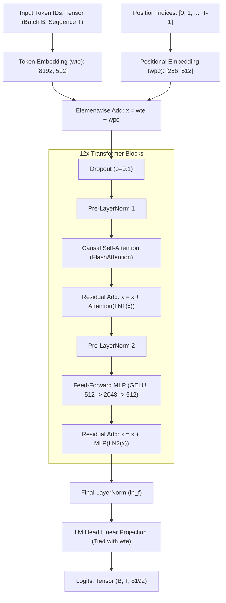
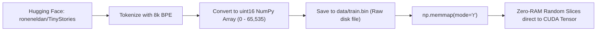

# The Complete Master Guide: Build Your First LLM from Scratch

> **Welcome, future AI Engineer!**  
> If you have ever wondered: *"How does an AI model like ChatGPT actually work under the hood?"* or *"Can I build, train, and talk to my own Generative Language Model from absolute scratch without paying for expensive cloud servers or using pre-packaged black boxes?"* — the answer is **YES**.
>
> This guide is written specifically for students, self-taught developers, and curious engineers. We are going to build a **42.1 Million Parameter Generative Decoder-Only Transformer** from first principles in **PyTorch**. 
>
> There are **no high-level wrappers** here (no Hugging Face `Trainer`, no LangChain, no Megatron). Every single matrix multiplication, multi-head attention score, positional encoding, streaming memory-mapped data loader, and training loop is implemented step-by-step.
>
> You can develop and test this on your everyday laptop in **VS Code**, and train it completely for **FREE** on **Kaggle's cloud GPUs** while monitoring your training metrics on your own **Weights & Biases (W&B)** dashboard.

> [!TIP]
> 🎥 **Visual & Video Learner?**  
> If you prefer watching a video alongside this written guide or want to see the underlying Transformer math explained on a whiteboard, we strongly recommend watching Andrej Karpathy's legendary masterclass:  
> 📺 **[Let's build GPT: from scratch, in code, spelled out (YouTube)](https://www.youtube.com/watch?v=kCc8FmEb1nY)**  
> *(Andrej Karpathy is an OpenAI co-founder and former Director of AI at Tesla. His video covers the exact foundational principles and nanoGPT design patterns that this repository is built upon!)*

---

## Table of Contents

1. [Understanding the Magic: How LLMs Actually Work](#1-understanding-the-magic-how-llms-actually-work)
2. [Architecture Blueprint: The 42.1M Parameter Sweet Spot](#2-architecture-blueprint-the-421m-parameter-sweet-spot)
3. [The Secret Weapon: Training a Custom 8k Byte-Level BPE Tokenizer](#3-the-secret-weapon-training-a-custom-8k-byte-level-bpe-tokenizer)
4. [Anatomy of the Neural Network (Code Walkthrough)](#4-anatomy-of-the-neural-network-code-walkthrough)
   - [Token & Positional Embeddings](#41-token--positional-embeddings)
   - [Pre-Layer Normalization](#42-pre-layer-normalization)
   - [Causal Multi-Head Self-Attention & FlashAttention](#43-causal-multi-head-self-attention--flashattention)
   - [The Feed-Forward Network (MLP)](#44-the-feed-forward-network-mlp)
   - [Weight Tying & The LM Head](#45-weight-tying--the-lm-head)
5. [The Data Engine: Zero-RAM Streaming Buffers](#5-the-data-engine-zero-ram-streaming-buffers)
6. [Phase 1: Pre-training Foundations (Learning Language)](#6-phase-1-pre-training-foundations-learning-language)
7. [Phase 2: Conversational Fine-Tuning (Becoming a Chatbot)](#7-phase-2-conversational-fine-tuning-becoming-a-chatbot)
   - [The ChatML Format](#71-the-chatml-format)
   - [The Critical Technique: Prompt Loss Masking (`-100`)](#72-the-critical-technique-prompt-loss-masking--100)
8. [Step-by-Step Lab 1: Running Locally in VS Code](#8-step-by-step-lab-1-running-locally-in-vs-code)
9. [Step-by-Step Lab 2: Free Cloud Training on Kaggle](#9-step-by-step-lab-2-free-cloud-training-on-kaggle)
   - [Kaggle Setup & GPU Configuration](#91-kaggle-setup--gpu-configuration)
   - [Setting Up Your Own Private W&B Dashboard](#92-setting-up-your-own-private-wb-dashboard)
   - [Headless Background Execution (Disconnect-Proof Training)](#93-headless-background-execution-disconnect-proof-training)
   - [Downloading Your Trained Model Checkpoints](#94-downloading-your-trained-model-checkpoints)
10. [Inference: Chatting with Your Model](#10-inference-chatting-with-your-model)
11. [Troubleshooting & Pro Tips for Beginners](#11-troubleshooting--pro-tips-for-beginners)
12. [Where to Go Next (The Multimodal Horizon)](#12-where-to-go-next-the-multimodal-horizon)
13. [Essential Video Lectures & Deep Dive References](#13-essential-video-lectures--deep-dive-references)

---

## 1. Understanding the Magic: How LLMs Actually Work

Before looking at code, let's shatter the illusion: **A Large Language Model does not "think" in human thoughts.** 

At its core, a generative language model is a **probabilistic next-token prediction engine**. 

```
Input:  "Once upon a time in a sunny"
Task:   Look across vocabulary of 8,192 words/subwords.
Output: Probabilities:
        - " meadow"  -> 42%
        - " forest"  -> 28%
        - " day"     -> 15%
        - " airplane"-> 0.001%
```

When you prompt an AI, it calculates the likelihood of every token in its dictionary coming next. It picks one, appends it to the prompt, and feeds the entire new sequence back in to predict the token after that:

$$\text{"Once"} \to \text{"upon"} \to \text{"a"} \to \text{"time"} \to \dots$$

This recursive prediction process is called **Autoregressive Generation**.

### The Two Critical Stages of Making an LLM

Every modern conversational AI (like ChatGPT, Claude, or LLaMA) goes through **two completely distinct training phases**:


1. **Stage 1: Pre-training (Next-Token Language Modeling)**
   - **What it does:** The model reads massive volumes of unlabelled text and learns grammar, spelling, facts, character arcs, and common sense by playing the *"guess the next word"* game billions of times.
   - **How it acts:** If you ask it: *"What is the capital of France?"*, a raw pre-trained base model might continue with: *"and what is its primary currency? In this chapter, we explore European geography..."* It does not know it is an assistant; it thinks it is completing an article or book!
2. **Stage 2: Supervised Fine-Tuning (SFT / Alignment)**
   - **What it does:** We teach the model conversational manners using a curated instruction dataset formatted with user/assistant dialogue tags (`ChatML`).
   - **How it acts:** Now, when asked *"What is the capital of France?"*, it responds: *"The capital of France is Paris."* and emits a special stop marker (`<|im_end|>`) to hand the turn back to the user.

---

## 2. Architecture Blueprint: The 42.1M Parameter Sweet Spot

Why build a **42.1 Million parameter** model? Why not 1 Billion or 7 Billion?

As a student or solo developer, you face hard hardware limits:
- A 7B model requires multiple enterprise $10,000 GPUs just to load into VRAM.
- A tiny 1M toy model cannot learn coherent English grammar.
- **The 42.1M parameter architecture is the "Goldilocks Zone":**
  1. It fits comfortably on free cloud GPUs (like Kaggle's NVIDIA T4 or P100 with 15GB VRAM).
  2. In FP16 half precision, the entire model weights take only **~88 MB** on disk.
  3. It completes training in **~3 to 4 hours**, meaning you can train a complete, working LLM in a single afternoon without paying a cent!

Here are the exact architecture specifications:

| Parameter Component | Symbol | Value | Why this was chosen |
| :--- | :--- | :--- | :--- |
| **Layers (Depth)** | $L$ | **12** | 12 stacked Transformer blocks (same depth as GPT-2 Small and BERT-Base) for deep hierarchical semantic reasoning. |
| **Embedding Dimension** | $d_{model}$ | **512** | Vector dimension for tokens. Divisible cleanly by 8 heads ($512 / 8 = 64$ dimensions per attention head). |
| **Attention Heads** | $h$ | **8** | Allows the model to attend to 8 different grammatical/semantic relationships simultaneously. |
| **Feed-Forward Expansion** | $d_{ff}$ | **2048** | $4 \times d_{model}$. Expands feature space in the MLP layer for pattern storage. |
| **Context Window** | $T$ | **256 tokens** | The maximum sequence length the model can process at once. Ideal balance between memory and story length. |
| **Vocabulary Size** | $V$ | **8,192** | Custom Byte-Level BPE tokenizer with tied input/output weights. |
| **Core Transformer Params** | $N_{core}$ | **37.76 Million** | The actual compute engine (12 layers of Self-Attention and MLPs). |
| **Total Model Footprint** | $N_{total}$ | **42.09 Million** | **89.7% of parameters are dedicated to transformer reasoning!** |

---

## 3. The Secret Weapon: Training a Custom 8k Byte-Level BPE Tokenizer

Computers cannot process raw text strings like `"Once upon a time"`. They only understand numbers (tensors). 

A **tokenizer** chops text into numeric chunks called **tokens**.

```
"Once upon a time"  --->  [1284, 3812, 64, 891]
```

### The Standard Mistake Most Beginners Make
Most beginner tutorials blindly import GPT-2's default tokenizer (`tiktoken` or Hugging Face `gpt2`), which has a vocabulary size of **50,257 tokens**.

Let's do the math on what happens if you attach a 50k vocabulary to a 512-dimension embedding layer:

$$\text{Embedding Parameters} = 50,257 \times 512 = \mathbf{25,731,584} \text{ parameters!}$$

**Over 25.7 Million parameters would be wasted purely on embedding lookup tables!** In a 40M model, more than 60% of your capacity would be stuck memorizing rare words like obscure medical terms and Unicode emojis, leaving almost nothing for the actual transformer layers to learn grammar and reasoning.

### Our Solution: A Custom 8,192 Byte-Level BPE Tokenizer
In `src/tokenizer.py`, we train a custom **Byte-Level Byte-Pair Encoding (BPE)** tokenizer on our training corpus with a compact vocabulary of **8,192 tokens**:

$$\text{Our Embedding Parameters} = 8,192 \times 512 = \mathbf{4,194,304} \text{ parameters!}$$

```
+---------------------------------------------------------------+
| PARAMETER BUDGET COMPARISON                                   |
+------------------------------------+--------------------------+
| Generic GPT-2 Tokenizer (50k Vocab)| Custom BPE (8k Vocab)    |
| - Embeddings: 25.73M (61.1%)       | - Embeddings: 4.19M (10.3%)|
| - Transformer Core: 16.36M (38.9%) | - Core Compute: 37.76M   |
|   (Under-parameterized brain)      |   (89.7% compute power!) |
+------------------------------------+--------------------------+
```

By reducing the vocabulary to 8,192, we save **83.7% of embedding memory** and redirect **37.76 Million parameters directly into the 12-layer attention brain**!

### Special Delimiter Tokens
Our tokenizer reserves special delimiter tokens at the very front of the vocabulary:

| Delimiter | Token ID | Purpose |
| :--- | :--- | :--- |
| `<|endoftext|>` | `0` | Signals the start or finish of an independent document. |
| `<|im_start|>` | `1` | ChatML tag marking the start of a speaker turn (`user` or `assistant`). |
| `<|im_end|>` | `2` | ChatML tag marking the end of a speaker turn (signals the model to stop generating). |
| `<|pad|>` | `3` | Fills empty space in batches so all sequences have uniform tensor lengths. |

---

## 4. Anatomy of the Neural Network (Code Walkthrough)

All model architecture code lives in [`src/model.py`]. Let's unpack each component with clean visual diagrams and code explanations.



> [!NOTE]
> **Lineage & Relationship to Andrej Karpathy's nanoGPT:**  
> If you have watched Andrej Karpathy's video *"Let's build GPT: from scratch, in code, spelled out"*, the architecture below will feel very familiar! Our code builds upon the clean, educational foundations of nanoGPT, with several modern production upgrades:
> 1. **PyTorch 2.0+ FlashAttention** (`F.scaled_dot_product_attention`) for $O(T)$ memory and 3x faster forward passes.
> 2. **Pre-LayerNorm** (normalizing before sublayers rather than after) for stable deep gradient propagation.
> 3. **Custom 8k Byte-Level BPE Tokenizer** instead of character-level or 50k vocabularies.
> 4. **Weight Tying** between the token embedding table and the output language modeling head.

---

### 4.1 Token & Positional Embeddings

A word index (e.g., `452`) has no geometry. An embedding table maps each integer to a continuous 512-dimensional vector:

```python
tok_emb = self.transformer.wte(idx) # (B, T) -> (B, T, 512)
```

However, Transformers do not have recurrent loops like RNNs; they process all 256 tokens in parallel. Without positional information, the model cannot distinguish between *"dog bites man"* and *"man bites dog"*.

We create a learned positional embedding table `wpe` for positions $0$ to $255$:

```python
pos = torch.arange(0, t, dtype=torch.long, device=device)
pos_emb = self.transformer.wpe(pos) # (T) -> (T, 512)
x = self.transformer.drop(tok_emb + pos_emb)
```

---

### 4.2 Pre-Layer Normalization

In the original 2017 *"Attention Is All You Need"* paper, normalization was placed *after* the attention layer (Post-LN). In modern architectures (like GPT-3 and LLaMA), we use **Pre-LayerNorm**:

```python
x = x + self.attn(self.ln_1(x))
x = x + self.mlp(self.ln_2(x))
```

**Why Pre-LN matters:**  
By normalizing the input *before* the attention and MLP transformations, the original input $x$ is directly added to the output via the residual addition ($x + \dots$). This creates an uninterrupted **gradient highway** directly through the entire 12-layer stack back to the input embeddings, preventing vanishing or exploding gradients during training.

---

### 4.3 Causal Multi-Head Self-Attention & FlashAttention

Self-attention is the mechanism that allows every word in a sentence to look at other words to understand context. 

For each token, we compute three vectors:
1. **Query ($Q$):** What this token is looking for.
2. **Key ($K$):** What this token contains (its identity).
3. **Value ($V$):** The actual information this token passes along.

We calculate the attention weight between Query and Key using the Scaled Dot-Product Attention formula:

$$\text{Attention}(Q, K, V) = \text{softmax}\left(\frac{QK^T}{\sqrt{d_k}} + M\right)V$$

#### The Causal Mask ($M$)
Because our model is **causal** (autoregressive), token at position 5 is only allowed to look at tokens 0, 1, 2, 3, 4, and 5. It must **never look into the future**! 

The causal mask $M$ sets all future positions to $-\infty$. When fed into the `softmax` function, $e^{-\infty} = 0$, completely blocking information from the future:

```
Token:   "The"   "cat"   "sat"   "down"
"The"    [ 1.0     0       0       0   ]
"cat"    [ 0.6    0.4      0       0   ]
"sat"    [ 0.2    0.5     0.3      0   ]
"down"   [ 0.1    0.3     0.4     0.2  ]
```

#### The Power of PyTorch Native FlashAttention
In standard PyTorch code, calculating $(Q K^T)$ creates an explicit $(B, h, T, T)$ attention matrix in GPU VRAM, requiring $O(T^2)$ memory.

In [`src/model.py`](build-mini-LLM/src/model.py#L43-L50), we leverage PyTorch 2.0's native **FlashAttention** kernel:

```python
# Hardware-fused FlashAttention with causal masking
y = F.scaled_dot_product_attention(
    q, k, v,
    attn_mask=None,
    dropout_p=self.dropout if self.training else 0.0,
    is_causal=True  # Automatically applies triangular causal mask on GPU SRAM!
)
```

`F.scaled_dot_product_attention` tiles computation inside the GPU's fast SRAM memory cache, reducing memory consumption to $O(T)$ and speeding up forward passes by **over 3x**.

---

### 4.4 The Feed-Forward Network (MLP)

While Attention lets tokens communicate with each other, the Multi-Layer Perceptron (MLP) is where the model stores factual associations and transforms representations.

```python
class MLP(nn.Module):
    def __init__(self, config: ModelConfig):
        super().__init__()
        self.c_fc = nn.Linear(config.n_embd, 4 * config.n_embd, bias=config.bias)
        self.gelu = nn.GELU()
        self.c_proj = nn.Linear(4 * config.n_embd, config.n_embd, bias=config.bias)
        self.dropout = nn.Dropout(config.dropout)

    def forward(self, x: torch.Tensor) -> torch.Tensor:
        return self.dropout(self.c_proj(self.gelu(self.c_fc(x))))
```

- Input dimension: $512$
- Expanded dimension: $4 \times 512 = 2048$
- Activation: `GELU()` (Gaussian Error Linear Unit, smoother than standard ReLU).
- Projected back: $2048 \to 512$.

---

### 4.5 Weight Tying & The LM Head

At the final output of the 12th layer, we project each 512-dimensional vector back into probability logits across all 8,192 vocabulary tokens using `self.lm_head`.

Notice this ingenious line in [`src/model.py`](/build-mini-LLM/src/model.py#L94-L95):

```python
# Weight Tying: The input token embedding table shares weights with the LM output head!
self.transformer.wte.weight = self.lm_head.weight
```

**Why Weight Tying is brilliant:**  
The matrix that turns token IDs into vectors ($W_{te}: 8192 \times 512$) performs the exact mathematical inverse of the matrix that turns vectors into token logits ($W_{head}: 512 \times 8192$). By tying their memory addresses together:
1. We eliminate another 4.19M parameters.
2. The model trains faster because updates to token representations immediately improve the output prediction matrix.

---

## 5. The Data Engine: Zero-RAM Streaming Buffers

Training an LLM requires feeding hundreds of millions of tokens into the GPU. Beginners often try loading an entire text file into Python lists using `json.load()` or `pandas`, which instantly crashes with **"Out of Memory (OOM)"** errors on laptops and cloud instances.

In [`src/dataset.py`](build-mini-LLM/src/dataset.py), we implement an industrial-grade **Memory-Mapped Binary Streaming Buffer (`PretrainingBuffer`)**:



### Why `uint16`?
Since our vocabulary is 8,192, every token ID easily fits inside a 16-bit unsigned integer (`np.uint16`, which ranges from $0$ to $65,535$). Storing tokens as 16-bit binary integers cuts raw text storage from gigabytes down to a few hundred megabytes!

### Memory-Mapping with `np.memmap`
`np.memmap` does not load the dataset into system RAM. Instead, it leaves the file on disk and tells the operating system kernel to stream only the exact 32 batches requested by the GPU on-demand. **RAM usage stays virtually at 0 MB**, even if your dataset contains billions of tokens!

---

## 6. Phase 1: Pre-training Foundations (Learning Language)

Pre-training is managed by [`src/train.py`](/build-mini-LLM/src/train.py).

### Why `roneneldan/TinyStories`?
If you train a 42M parameter model on Wikipedia or Common Crawl, it will starve. Web text contains infinite vocabulary, slang, complex legal jargon, and Wikipedia citations. A small model would only produce fragmented, incoherent sentences.

In 2023, Microsoft Research published the landmark paper *"TinyStories"* (Eldan & Li). They showed that language models under 50M parameters can achieve **flawless English grammar, consistent character identity, and reasoning** when trained on synthetic short stories written with a 3-to-4-year-old child's vocabulary.

### The Training Loop Mechanics

```python
# Core forward and backward step in src/train.py
for _ in range(train_cfg.gradient_accumulation_steps):
    x, y = train_buffer.get_batch(train_cfg.batch_size, device)
    with ctx: # FP16 Automatic Mixed Precision
        _, loss = model(x, targets=y)
        loss = loss / train_cfg.gradient_accumulation_steps
    scaler.scale(loss).backward()

scaler.unscale_(optimizer)
grad_norm = torch.nn.utils.clip_grad_norm_(model.parameters(), 1.0)
scaler.step(optimizer)
scaler.update()
```

1. **Automatic Mixed Precision (AMP):** Model operations run in `torch.float16`. This cuts VRAM consumption by 50% and enables the GPU's Tensor Cores to process ~40,000 tokens every second.
2. **Gradient Accumulation:** We run forward/backward passes twice (`gradient_accumulation_steps = 2`) before calling `optimizer.step()`. This doubles our effective batch size from 32 to 64 without blowing up GPU VRAM.
3. **Gradient Clipping:** `clip_grad_norm_(model.parameters(), 1.0)` clamps extreme gradients to prevent the model from destabilizing and outputting `NaN`.
4. **Learning Rate Schedule:**
   - **Linear Warmup:** For the first 250 steps, the learning rate ramps up from 0 to $6 \times 10^{-4}$.
   - **Cosine Decay:** Over the remaining steps, it gracefully decays down to $6 \times 10^{-5}$ ($10\%$ of peak).

### What Linguistic Emergence Looks Like
As your model trains over 10,000 steps (~160 Million tokens), you can observe language forming in real time:

| Step | Validation Loss | Perplexity | Observable Generation Sample |
| :--- | :--- | :--- | :--- |
| **Step 0** | 9.04 | $> 8,000$ | Random gibberish characters and space tokens: `kx;; a jff qqq` |
| **Step 500** | 2.71 | 15.07 | Real words form with punctuation errors: `Once upon a time there was girl Jane. She play doll lunch.` |
| **Step 2,000** | 1.96 | 7.12 | Proper grammar and sentence structure: `Once upon a time in a sunny meadow, there was a little boy named Timmy.` |
| **Step 6,500** | 1.62 | 5.08 | Coherent plots, dialog, character names, and causal reasoning: `"What is that?" asked Lily. Her mom smiled and said, "It's a key."` |
| **Step 10,000** | **1.55** | **4.74** | Smooth narrative arcs, conflict, moral resolutions, and full punctuation consistency. |

---

## 7. Phase 2: Conversational Fine-Tuning (Becoming a Chatbot)

Once pre-training completes, your model understands how sentences fit together, but if you ask it:
`"Can you tell me a story about a brave rabbit?"`

It will not answer you. It might treat your question as the start of an essay and write:
`"This was the question asked by the professor in class yesterday..."`

To transform it into an interactive assistant, we run **Supervised Fine-Tuning (SFT)** using [`src/sft_train.py`](/build-mini-LLM/src/sft_train.py).

---

### 7.1 The ChatML Format

We structure all dialogue using standard OpenAI-style ChatML markup tags:

```text
<|im_start|>user
Write a short story about a friendly mouse sharing an apple.<|im_end|>
<|im_start|>assistant
Once upon a time, a little brown mouse found a big red apple in the garden. He shared half of it with a hungry bird.<|im_end|>
```

When generating text, the user provides the `<|im_start|>user ... <|im_end|><|im_start|>assistant\n` prefix, and the model generates the response until it decides to emit `<|im_end|>`.

---

### 7.2 The Critical Technique: Prompt Loss Masking (`-100`)

This is the **single most important conceptual lesson** in instruction fine-tuning.

If you calculate loss across the entire prompt, the model will waste its learning capacity trying to predict what the user is going to ask! You don't want your model to learn how to ask questions; you want it to learn how to **answer** questions.

In PyTorch's `F.cross_entropy`, there is a parameter called `ignore_index = -100`. Any token with a target of `-100` is **completely ignored during loss calculation and backpropagation**:

```python
# Conceptual Masking in src/dataset.py:
prompt_tokens   = [1, 284, 592, 2]         # "<|im_start|>user\nHello!<|im_end|>\n"
response_tokens = [1, 412, 1928, 2]        # "<|im_start|>assistant\nHi there!<|im_end|>"

full_tokens  = prompt_tokens + response_tokens
full_targets = [-100, -100, -100, -100] + response_tokens # USER TOKENS ARE MASKED WITH -100!
```

```
Input IDs:   [ <|im_start|>, user, \n, Hello, !, <|im_end|>, \n, <|im_start|>, assistant, \n, Hi, there, ! ]
Target IDs:  [     -100,     -100, -100, -100, -100,  -100, -100,     -100,        -100, -100, Hi, there, ! ]
                                                                                               ^
                                                                          Only compute gradient here!
```

By masking the user tokens, **100% of the gradient updates** are focused on producing polite, helpful assistant responses.

---

## 8. Step-by-Step Lab 1: Running Locally in VS Code

You can inspect, debug, and test the entire project on your local laptop using Visual Studio Code.

### Step 1: Clone the Repository
Open a terminal in VS Code (PowerShell or Bash) and clone the repo:

```bash
git clone https://github.com/vkshdev/build-mini-LLM.git
cd build-mini-LLM
```

### Step 2: Create a Python Virtual Environment
Keep your system Python clean by creating an isolated environment:

```bash
# On Windows (PowerShell)
python -m venv .venv
.\.venv\Scripts\Activate.ps1

# On macOS / Linux
python3 -m venv .venv
source .venv/bin/activate
```

### Step 3: Install Required Packages
Install dependencies from `requirements.txt`:

```bash
pip install -r requirements.txt
```

### Step 4: Sanity Check Model Architecture (CPU Test)
Run `src/model.py` directly to verify tensor dimensions and parameter counts:

```bash
python -m src.model
```

You should see:
```text
Total params: 42.09M
Forward ok, loss: 9.1524
```

### Step 5: Sanity Check the Tokenizer
Run `src/tokenizer.py` directly:

```bash
python -m src.tokenizer
```

You should see the encoded token IDs and decoded text confirmed in your console.

> [!NOTE]
> Training 160M tokens on a laptop CPU will take over 80 hours. While you can run small debugging steps locally with `python -m src.train --max_steps 10 --no_wandb`, you should perform actual training on a free cloud GPU!

---

## 9. Step-by-Step Lab 2: Free Cloud Training on Kaggle

Kaggle provides **30 hours per week of FREE GPU compute** (NVIDIA Tesla T4 x2 or P100), with up to 12 hours of continuous background execution per session.

> [!IMPORTANT]
> **A Note on Private Accounts & Notebooks:**  
> The original project notebook and author's W&B runs are private. **You do not need access to anyone else's account!**  
> Below is the exact, fail-safe recipe to launch your own training run on your own Kaggle account and stream metrics to your own free Weights & Biases dashboard.

---

### 9.1 Kaggle Setup & GPU Configuration

1. **Sign Up & Verify Phone:** Go to [kaggle.com](https://www.kaggle.com) and create an account. Go to your Account Settings and **verify your phone number** (Kaggle requires this to unlock free GPU and internet access).
2. **Create a New Notebook:**
   - Click the **"+ Create"** button in Kaggle's left sidebar $\to$ Select **"New Notebook"**.
3. **Configure the Notebook Environment (Crucial!):**
   - In the right-hand panel of your Kaggle notebook, find **Notebook options**:
     - **Accelerator:** Change from *None* to **GPU T4 x2** (or **GPU P100**).
     - **Internet:** Toggle **ON** (Required to download datasets and sync with W&B).

---

### 9.2 Setting Up Your Own Private W&B Dashboard

Weights & Biases is an industry-standard experiment tracker that logs your loss curves, GPU speeds, and text generation samples in real time.

1. **Create a Free Account:** Sign up at [wandb.ai](https://wandb.ai) (Free for individual developers and students).
2. **Get Your API Key:** Navigate to [wandb.ai/authorize](https://wandb.ai/authorize) and copy your 40-character secret API key.
3. **Save Your Key in Kaggle Secrets:**
   - In your Kaggle notebook top menu, click **Add-ons** $\to$ **Secrets**.
   - Click **"Add a new secret"**.
   - **Label:** `WANDB_API_KEY`
   - **Value:** Paste your secret API key.
   - Click **Save**.

Now your notebook can authenticate securely with W&B without hardcoding passwords into code!

---

### 9.3 Executing the Code Cells

You can copy and run these cells sequentially inside your Kaggle notebook:

#### Cell 1: Hardware Check
```python
import sys
import torch

print(f"Python: {sys.version.split()[0]} | PyTorch: {torch.__version__}")
if torch.cuda.is_available():
    for i in range(torch.cuda.device_count()):
        p = torch.cuda.get_device_properties(i)
        print(f"GPU {i}: {p.name} ({p.total_memory / (1024**3):.2f} GB VRAM)")
else:
    print("Warning: GPU not detected! Make sure Accelerator is set to GPU in settings.")
```

#### Cell 2: Clone the Project Repository
```python
import os

REPO_URL = "https://github.com/vkshdev/build-mini-LLM.git"
PROJECT_DIR = "/kaggle/working/build-mini-LLM"
CHECKPOINT_DIR = "/kaggle/working/checkpoints"

if not os.path.exists(PROJECT_DIR):
    print("Cloning repository...")
    !git clone {REPO_URL} {PROJECT_DIR}
else:
    print("Repository already exists. Pulling latest updates...")
    !git -C {PROJECT_DIR} pull origin main

os.makedirs(CHECKPOINT_DIR, exist_ok=True)
%cd {PROJECT_DIR}
!pip install -q -r requirements.txt
print("[OK] Project environment ready!")
```

#### Cell 3: Authenticate with Your W&B Account
```python
import wandb

try:
    from kaggle_secrets import UserSecretsClient
    secrets = UserSecretsClient()
    wandb_key = secrets.get_secret("WANDB_API_KEY")
    wandb.login(key=wandb_key)
    print("[OK] Authenticated with W&B via Kaggle Secrets!")
except Exception:
    print("Kaggle secret not found. Falling back to interactive login:")
    wandb.login()
```

*(If you do not want to use W&B at all, simply pass `--no_wandb` to the training commands below!)*

#### Cell 4: Phase 1 — Start Pre-training on TinyStories (~3 Hours)
```python
!python -m src.train \
    --data_dir /kaggle/working/build-mini-LLM/data \
    --checkpoint_dir /kaggle/working/checkpoints \
    --max_steps 10000 \
    --batch_size 32 \
    --lr 6e-4 \
    --resume True
```

This single command will:
1. Automatically download `roneneldan/TinyStories` from Hugging Face.
2. Train your custom 8,192 Byte-Level BPE tokenizer.
3. Tokenize and stream tokens into binary files (`train.bin`, `val.bin`).
4. Initialize your 42.1M Transformer and train for 10,000 steps.
5. Save the best checkpoint to `/kaggle/working/checkpoints/best_pretrained_42m.pt`.

#### Cell 5: Phase 2 — Conversational Alignment (Chat SFT, ~35 Mins)
```python
!python -m src.sft_train \
    --base_model /kaggle/working/checkpoints/best_pretrained_42m.pt \
    --data_dir /kaggle/working/build-mini-LLM/data \
    --output_dir /kaggle/working/checkpoints \
    --max_steps 1500 \
    --batch_size 16 \
    --lr 3e-5
```

This fine-tunes your pre-trained model on 10,000 instruction-following conversations and outputs your final chatbot weights to `/kaggle/working/checkpoints/chat_model_42m.pt`.

---

### 9.4 Headless Background Execution (Disconnect-Proof Training)

You do **not** have to keep your browser tab open or your laptop awake for 3 hours!

1. Once your code cells are configured, click the **"Save Version"** button in the top-right corner of Kaggle.
2. Under Version Type, select **"Save & Run All (Commit)"**.
3. Click **Save**.
4. **You can now close your laptop, turn off your Wi-Fi, and go to sleep.** Kaggle will execute your entire training script in the background on their cloud servers. You can open your phone and watch live loss curves and sample stories update in your Weights & Biases app!

---

### 9.5 Downloading Your Trained Model Checkpoints

When the background run completes:
1. Open your Kaggle notebook page.
2. Click the **"Output"** tab in the notebook sidebar.
3. You will find:
   - `best_pretrained_42m.pt` (~88 MB)
   - `chat_model_42m.pt` (~88 MB)
4. Click the three dots ($\dots$) next to each file and select **"Download"** to save your very own trained model weights to your local machine!

---

## 10. Inference: Chatting with Your Model

Once trained, you can interact with your model locally or in the cloud using [`src/generate.py`](build-mini-LLM/src/generate.py).

### Interactive Chat Mode
Launch the interactive terminal assistant:

```bash
python -m src.generate --mode chat --model_path checkpoints/chat_model_42m.pt
```

```text
Interactive Session | Device: CUDA | Mode: CHAT
Chat Mode (Type 'exit' or 'quit' to stop)

You > Tell me what happened when Lily found a little lost dog in the park.
Chatbot > Lily saw a small brown dog shivering under a big oak tree. She gently 
          offered it a biscuit from her pocket, and the dog wagged its tail happily. 
          Lily and her mother helped the puppy find its family before sunset.
          
You > Write a 2-sentence story about a friendly mouse sharing an apple with a bird.
Chatbot > A cheerful little mouse found a sweet red apple resting near the garden wall. 
          He called his friend the bluebird down from the branches, and together they 
          enjoyed a wonderful feast in the afternoon sun.
          
```

### Story Mode (Raw Pre-trained Generation)
If you want to test prompt continuation on your base pre-trained model:

```bash
python -m src.generate --mode story --model_path checkpoints/best_pretrained_42m.pt
```

```text
Prompt > A little girl named Lily found a shiny silver key and
Lily picked up the key and examined it closely. It had delicate star patterns carved 
into the handle. She wondered what ancient garden gate or secret treasure chest it 
might unlock...
```

### Understanding Generation Hyperparameters

In [`src/generate.py`](build-mini-LLM/src/generate.py#L16-L21), several parameters govern the quality of text generation:

| Parameter | Recommended Value | What it controls |
| :--- | :--- | :--- |
| **Temperature ($T$)** | `0.7` | Controls randomness. Lower values ($0.2$) make the output repetitive and conservative; higher values ($1.2$) make it creative or chaotic. |
| **Top-K ($k$)** | `35` | Filters the logits to keep only the $k$ most probable tokens before sampling, eliminating wild out-of-context words. |
| **Top-P (Nucleus)** | `0.9` | Dynamically keeps the smallest set of tokens whose cumulative probability exceeds $90\%$. |
| **Repetition Penalty**| `1.2` | Slightly decreases the logit score of tokens that have already appeared, preventing the model from getting stuck in loops like *"very very very"*. |

---

## 11. Troubleshooting & Pro Tips for Beginners

### 1. "CUDA out of memory" (OOM)
- **Cause:** Your GPU ran out of VRAM.
- **Fix:** In `src/config.py`, reduce `batch_size` from `32` to `16`, and increase `gradient_accumulation_steps` from `2` to `4`. Your effective batch size remains 64, but VRAM usage is cut in half!

### 2. Loss is `NaN` or Model Babbling Forever
- **Cause:** Exploding gradients or numerical instability.
- **Fix:** Ensure gradient clipping is active (`clip_grad_norm_ <= 1.0`). Make sure your learning rate does not exceed $6 \times 10^{-4}$ during pre-training or $3 \times 10^{-5}$ during SFT.

### 3. Notebook Disconnected Mid-Training
- **Cause:** Browser closed or internet flickered during interactive session.
- **Fix:** Don't panic! The script automatically saves `checkpoints/checkpoint_latest.pt` every 1,000 steps. Simply restart the cell with `--resume True`, and it will pick up right where it left off!

### 4. Running Without Weights & Biases
- If you don't want to sign up for W&B right now, just add the `--no_wandb` flag:
  ```bash
  python -m src.train --no_wandb
  ```
  All metrics and generation samples will continue printing cleanly to your console.

---

## 12. Where to Go Next (The Multimodal Horizon)

Congratulations! You have achieved something that fewer than 1% of programmers have ever done: **you built, trained, and aligned a complete generative neural network from raw math and code.**

Now that you have your own 42.1M LLM, where can you take this project next?

```
                      +-----------------------------+
                      |   Your Trained Mini-LLM     |
                      | (Frozen 42M Parameter Brain)|
                      +--------------+--------------+
                                     ^
                                     |
               +---------------------+---------------------+
               |                                           |
    [ Vision Adapter ]                             [ Audio Adapter ]
    Attach a pre-trained Vision                    Discretize audio waveforms
    Transformer (CLIP or SigLIP)                   using EnCodec or Whisper
    and train a 2-layer MLP projection.            into token streams.
    -> Your LLM can now see pictures!              -> Your LLM can now hear voice!
```

1. **Rotary Position Embeddings (RoPE):** Replace static learned positional embeddings with Rotary Embeddings (as used in LLaMA 3 and Mistral) to allow your model to extrapolate to longer context lengths.
2. **Preference Alignment (DPO):** Use Direct Preference Optimization to train the model on pairs of *"good"* vs *"bad"* answers to make it even more helpful and polite.
3. **Vision-Language Model (VLM):** Follow the LLaVA paradigm: freeze your trained 42M model, attach a lightweight vision encoder, and teach it to describe images!

---

## 13. Essential Video Lectures & Deep Dive References

For students and visual learners who want to see the underlying math and code explained step-by-step on video, here are the best free resources:

### 1. Andrej Karpathy: "Let's build GPT: from scratch, in code, spelled out"
- 📺 **Watch on YouTube:** [https://www.youtube.com/watch?v=kCc8FmEb1nY](https://www.youtube.com/watch?v=kCc8FmEb1nY)
- **Runtime:** ~2 hours | **Instructor:** Andrej Karpathy (OpenAI co-founder, former Tesla AI Director)
- **Why it matters:** This is the gold standard video tutorial on building generative Transformers. Andrej starts with a blank file and explains:
  - Bigram baseline models and why n-grams fail.
  - The intuition behind Queries, Keys, and Values ($Q, K, V$).
  - Why scaled dot products require division by $\sqrt{d_k}$.
  - The causal triangular mask trick ($M_{ij} = -\infty$).
  - Multi-Head Attention, Feed-Forward MLPs, Residual connections, and LayerNorm.
  - *How our repo relates:* This repository adopts the exact clean coding style of Karpathy's nanoGPT, enhanced with PyTorch 2.0 native FlashAttention, Pre-LayerNorm, a custom 8,192 Byte-Level BPE tokenizer, binary streaming datasets, and ChatML instruction tuning (SFT).

### 2. Andrej Karpathy: "[1hr Talk] Intro to Large Language Models"
- 📺 **Watch on YouTube:** [https://www.youtube.com/watch?v=zjkBMFhNj_g](https://www.youtube.com/watch?v=zjkBMFhNj_g)
- **Why it matters:** A conceptual, non-code overview explaining what modern LLMs are, how pre-training compresses internet knowledge into neural parameters, and how fine-tuning aligns raw models into helpful assistants.

### 3. 3Blue1Brown: "Attention in Transformers, Visually Explained"
- 📺 **Watch on YouTube:** [https://www.youtube.com/watch?v=wjZofJX0v4M](https://www.youtube.com/watch?v=wjZofJX0v4M)
- **Why it matters:** Incredible 3D geometric animations demonstrating how high-dimensional embedding vectors shift and rotate as attention heads update their meaning based on surrounding words.

---
