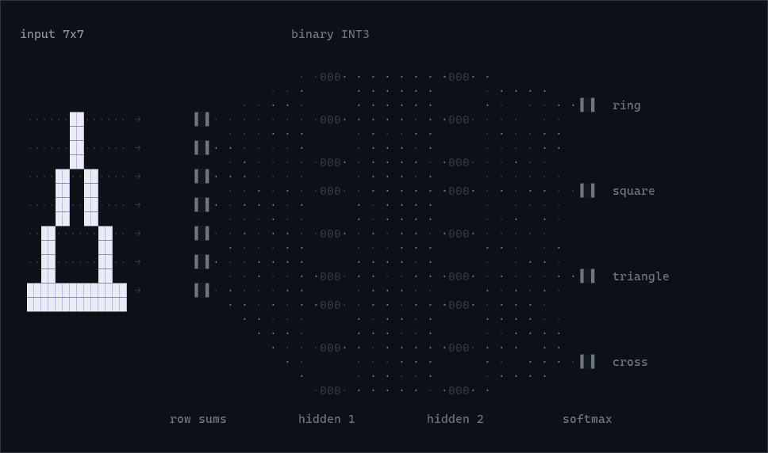

# build-mini-LLM

### Building a 42M Generative Transformer from Scratch in PyTorch

 

  

[Read Full Technical Report on Weights & Biases](https://forge.coreweave.com/wandb/vkshdev-self/build-mini-LLM/reports/Building-a-Mini-LLM-from-Scratch--VmlldzoxODMxODc2NA?accessToken=wq5ui9gmd4b0i7uykev1jotre060e1pgzxghy3pcaiyr6hcmxawa3cu9rzonml3a)

---

## Overview

This is an end-to-end autoregressive language model project from first principles in PyTorch. There are no high-level trainer wrappers or imported transformer packages. Every layer, attention score, streaming data buffer, and training loop is built directly from scratch.

Training follows the modern two-stage process:
1. **Pre-training:** Next-token language modeling on 160M tokens of synthetic stories (`roneneldan/TinyStories`).
2. **Instruction Tuning (SFT):** Alignment into a conversational chatbot using ChatML formatting on filtered instruction data (`tatsu-lab/alpaca`).

All experiments, loss curves, and emergent generations are tracked live in [Weights & Biases](https://forge.coreweave.com/wandb/vkshdev-self/build-mini-LLM/reports/Building-a-Mini-LLM-from-Scratch--VmlldzoxODMxODc2NA?accessToken=wq5ui9gmd4b0i7uykev1jotre060e1pgzxghy3pcaiyr6hcmxawa3cu9rzonml3a).

---

## Key Results

| Metric | Pre-trained Base Model | Conversational Chat Model |
| :--- | :--- | :--- |
| **Validation Loss** | 1.5556 | 3.4893 |
| **Perplexity** | 4.74 | 32.76 |
| **Training Dataset** | TinyStories (160M tokens) | Filtered Alpaca (10k instructions) |
| **Throughput (NVIDIA T4)** | 40,500 tokens/sec | 115 - 130 tokens/sec (Inference) |
| **FP16 Checkpoint Size** | 88.30 MB | 88.30 MB |

---

## Model Architecture

The model is a 12-layer causal decoder-only Transformer :

* **Layers:** 12 Transformer blocks with PyTorch FlashAttention and Pre-LayerNorm.
* **Dimensions:** 512 embedding size, 8 attention heads, 2048 MLP expansion.
* **Context Length:** 256 tokens.
* **Custom 8k Tokenizer:** Instead of a generic 50k GPT-2 vocabulary that consumes over half of the model's parameters in embeddings alone, we trained an 8,192 Byte-Level BPE tokenizer. This saved 83.7% of embedding memory and reserved 89.7% of the parameter budget (37.76M) directly for the core transformer compute.
* **Total Parameters:** 42.09 Million.

---
