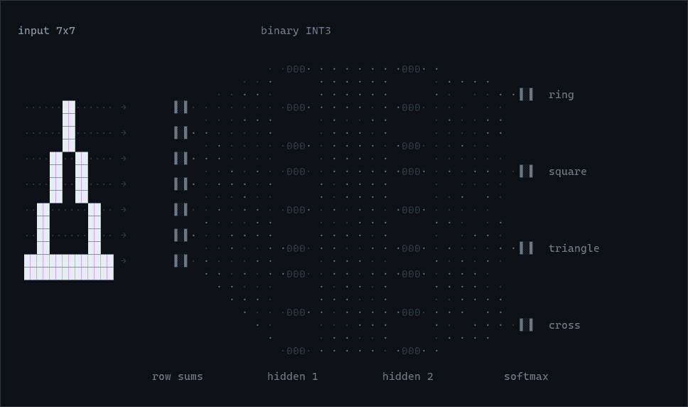

<div align="center">

## Building a Generative LLM from Scratch • Decoder-Only Transformer
*An Open Educational Deep Learning Project • Trained on Google Colab GPUs • Tracked with Weights & Biases (W&B)*

<p align="center">
  
</p>

<br>

</div>

> It serves as an open, accessible learning reference for students, engineers, and researchers wanting to understand how Large Language Models operate under the hood. Architecture refinements, pre-training runs, and loss convergence tracking are currently underway on Google Colab GPUs with real-time telemetry in Weights & Biases.

---

## What Is This Project?

Rather than importing an off-the-shelf model or fine-tuning an existing checkpoint with two lines of code, this project is an end-to-end educational journey of building a **generative Large Language Model from the ground up**.

The pedagogical goal is to **demystify the black box of modern autoregressive Transformers**. Every matrix multiplication, attention score, residual connection, and training loop is implemented from first principles in PyTorch designed to teach how deep learning models actually train under real-world constraints (like free-tier Google Colab GPUs) while observing authentic language emergence.

---

## How It Works

We train the model in two simple steps, the same way big models like ChatGPT or Llama are made, just at a smaller size (~28M parameters):
```
[ Raw Text Data ] ──> [ Stage 1: Pre-training ] ──> [ Foundational Model ]
                                                            │
                                                            ▼
[ Conversational Chatbot ] <── [ Stage 2: SFT / Chat ] <────┘
```
---
